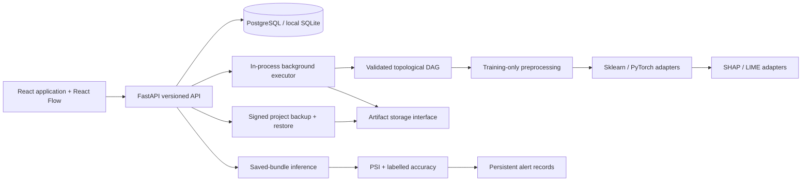

# Architecture

The frontend separates server state (TanStack Query), active project state, graph editor state, and forms. Domain types describe the neutral DAG and backend responses. A persistent sidebar keeps navigation and project context consistent; requests display loading, empty, and error states.

The API validates Pydantic inputs and delegates dataset, execution, registry, deployment, monitoring, and recovery work to services. SQLAlchemy persists metadata; no browser-only run history is authoritative. Alembic owns schema upgrades. Large data and serialized models remain in artifact storage behind an interface with confined paths and SHA-256 integrity metadata.

The DAG executor obtains datasets through a resolver and emits node/log callbacks. It does not own database sessions. Node operations consume data/model contexts; adapter interfaces isolate model algorithms and explainer libraries. The service persists callbacks so the editor can poll a run without blocking its UI.

Every run stores a complete graph snapshot and version, configuration, environment, timing, metrics, status and errors. Model registration adds an immutable version and producing-run lineage. Serving loads its saved preprocessing/model bundle. Prediction requests persist raw input metadata locally, predictions, latency, optional labels and errors; monitoring computes real aggregate statistics and records alert breaches.

Recovery gathers only one project's metadata and referenced files. It authenticates the manifest before extracting, checks sizes/paths/checksums/relationships, remaps identifiers and artifact paths, and restores into a new project. Backup signing secrets are managed separately.

The executor is deliberately single-process. A distributed queue can replace the executor boundary, and an object store can replace the local storage implementation. Authentication and tenant authorization must precede any shared public deployment.
